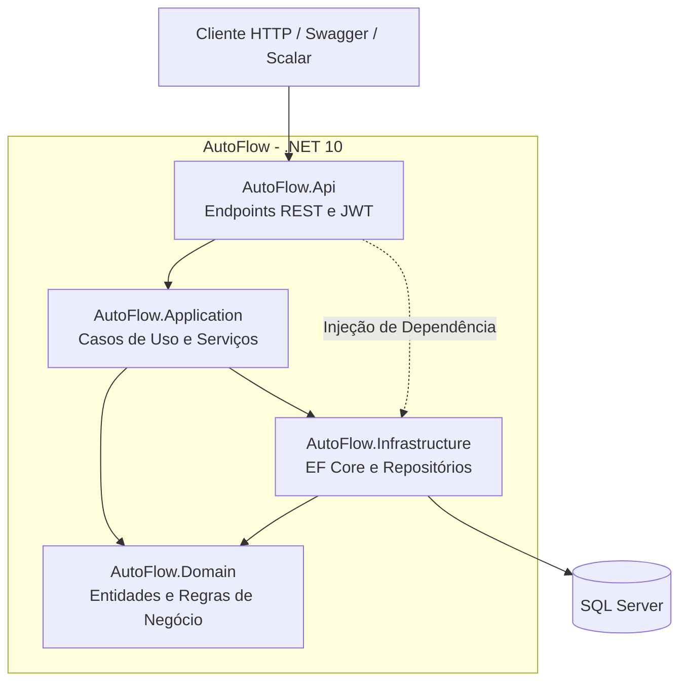
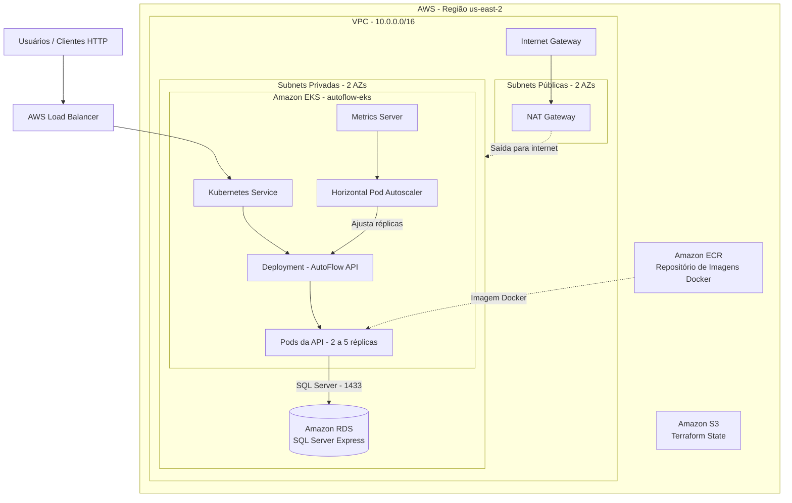
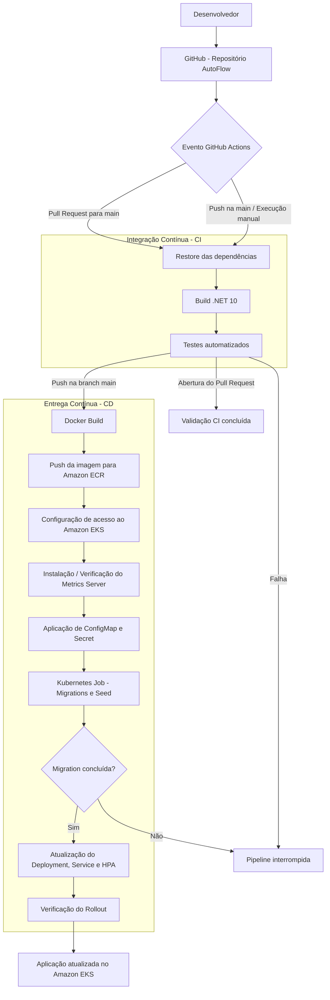
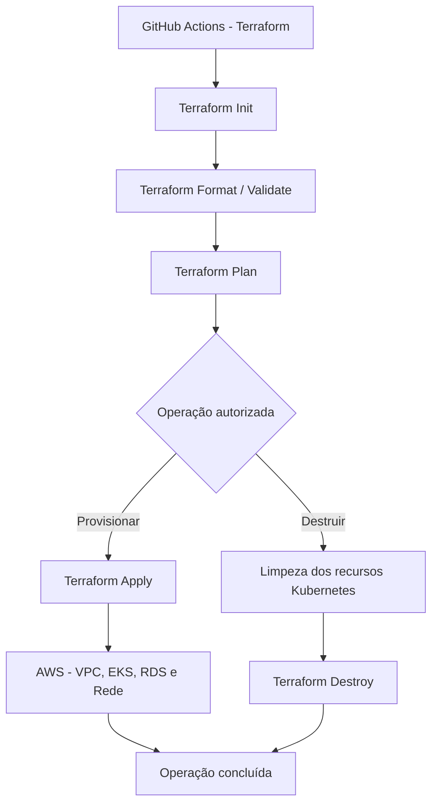

# AutoFlow — Gestão de Oficina Mecânica

## Visão Geral

O **AutoFlow** é um sistema de gestão de oficinas mecânicas desenvolvido durante o Tech Challenge da Pós-Graduação em Arquitetura de Software da FIAP.

Na **Fase 1**, foi desenvolvida uma API REST utilizando **.NET 10 e ASP.NET Core**, com arquitetura em camadas, responsável pelo gerenciamento de clientes, veículos, serviços, peças e ordens de serviço. A solução contempla o acompanhamento do ciclo de vida das ordens de serviço, desde sua abertura até a conclusão e entrega do veículo.

Na **Fase 2**, o projeto evoluiu para atender a um cenário de crescimento da demanda, expansão da oficina para novas unidades e necessidade de maior disponibilidade e escalabilidade.

Para isso, a aplicação passou a utilizar **Docker**, **Kubernetes**, **Terraform**, **GitHub Actions** e serviços da **Amazon Web Services (AWS)**, incorporando práticas de Infraestrutura como Código (IaC), Integração Contínua e Entrega Contínua (CI/CD).

### Objetivos da Fase 2

- **Qualidade e organização do código:** aprimorar a estrutura da aplicação, aplicando princípios de Clean Code, Clean Architecture e testes automatizados.
- **Conteinerização:** padronizar a execução da aplicação por meio do Docker, utilizando Docker Compose para o ambiente de desenvolvimento local.
- **Escalabilidade:** utilizar Kubernetes e Horizontal Pod Autoscaler (HPA) para ajustar automaticamente a quantidade de Pods conforme o consumo de CPU e memória.
- **Disponibilidade e resiliência:** executar múltiplas réplicas da aplicação, permitindo a recuperação automática de Pods e reduzindo a dependência de uma única instância.
- **Infraestrutura como Código:** automatizar o provisionamento dos recursos AWS, incluindo rede, cluster Amazon EKS e banco de dados Amazon RDS, utilizando Terraform.
- **Automação de CI/CD:** implementar pipelines com GitHub Actions para compilação, execução de testes, construção e publicação de imagens Docker e deploy automatizado no Kubernetes.
- **Segurança e gerenciamento de configurações:** utilizar ConfigMaps e Secrets para separar configurações e credenciais do código-fonte, mantendo o banco de dados em uma rede privada.
- **Reprodutibilidade:** garantir que a infraestrutura possa ser destruída e reconstruída de maneira automatizada, reduzindo a dependência de configurações manuais.

### Resultado Esperado

Com essa evolução, o AutoFlow busca oferecer uma arquitetura mais escalável, resiliente e sustentável, preparada para suportar o crescimento da demanda e a execução de múltiplas instâncias da aplicação.

A infraestrutura foi validada por meio de testes de deploy automatizado, escalabilidade horizontal e reconstrução completa do ambiente com Terraform, demonstrando a integração entre aplicação, infraestrutura e automação.

## Estrutura do projeto

```
.github/                           # Pipeline de CI/CD
infra/                             # scripts em Terraform para provisionamento do cluster Kubernetes
k8s/                               # Manifestos kubernetes
src/backend/
├── AutoFlow.slnx                  # Solução (.NET)
├── docker-compose.yml             # Orquestração dos containers (API + SQL Server)
├── docker-compose.override.yml    # Configuração local de desenvolvimento
├── src/
│   ├── AutoFlow.Api/              # Camada de apresentação (Minimal APIs, endpoints, autenticação JWT)
│   ├── AutoFlow.Application/      # Casos de uso, DTOs, validadores, regras de aplicação
│   ├── AutoFlow.Domain/           # Entidades, value objects e regras de negócio
│   └── AutoFlow.Infrastructure/   # Persistência (EF Core), migrations, repositórios, geração de token
└── tests/
    ├── AutoFlow.UnitTests/         # Testes unitários (domínio, validadores, serviços)
    └── AutoFlow.IntegrationTests/  # Testes de integração dos endpoints (WebApplicationFactory + SQLite em memória)
```

### Domínio

- **Cliente** — cadastro de clientes da oficina (documento CPF/CNPJ, e-mail, telefone).
- **Veículo** — veículos vinculados a um cliente (placa, chassi, quilometragem, combustível, tipo).
- **Serviço** — serviços oferecidos pela oficina (nome único, preço, tempo médio de execução).
- **Peça/Insumo** — peças e insumos utilizados nos serviços (nome, valor); ao ser cadastrada, gera
  automaticamente um **Estoque** associado com quantidade zero.
- **Estoque** — controla a quantidade de uma peça/insumo, com movimentações de entrada, saída
  (validando disponibilidade) e ajuste (definição direta da quantidade).
- **Usuario** — conta de acesso com perfil `Colaborador` (equipe da oficina) ou `Cliente`
  (vinculado a um `Cliente` existente), usada para autenticação.
- **Ordem de Serviço** — controla o fluxo completo da recepção à entrega do veículo, com diagnóstico,
  serviços e peças em snapshot, orçamento, aprovação/reprovação pelo cliente, execução e histórico de datas.

## Arquitetura e decisões técnicas

A solução segue a regra de dependência da Clean Architecture: as setas de
referência de projeto sempre apontam para dentro, em direção ao domínio.

```text
AutoFlow.Api  →  AutoFlow.Application  →  AutoFlow.Domain
                          ↑
              AutoFlow.Infrastructure
```


- **Domain** não referencia nenhum outro projeto — concentra entidades, value
  objects e regras de negócio puras, sem dependência de EF Core, ASP.NET ou
  qualquer detalhe de infraestrutura.
- **Application** referencia apenas o Domain — define casos de uso, DTOs e
  interfaces (`IXxxRepositorio`, `IXxxService`) que a Infrastructure implementa,
  seguindo o Dependency Inversion Principle.
- **Infrastructure** implementa as interfaces da Application (EF Core,
  repositórios, geração de token) e pode ser trocada (ex.: outro banco, outro
  provedor de token) sem alterar regra de negócio.
- **Api** é a camada mais externa, responsável por expor os casos de uso via
  Minimal APIs.

O objetivo é manter o domínio testável e isolado de detalhes de framework, e
permitir que decisões de infraestrutura (banco, autenticação) mudem com o
menor impacto possível no restante do código. Optou-se por **Minimal APIs**
em vez de Controllers por serem mais enxutas e alinhadas à direção atual do
ASP.NET Core para APIs simples.



### Por que JWT customizado em vez de ASP.NET Core Identity

A autenticação foi implementada com entidades próprias (`Usuario`/`Perfil`) e
`Microsoft.AspNetCore.Authentication.JwtBearer`, em vez do ASP.NET Core
Identity. O Identity adiciona ~7 tabelas próprias (`AspNetUsers`,
`AspNetRoles`, etc.), exige que o `DbContext` herde de `IdentityDbContext` e,
mesmo assim, não emite JWT sozinho — ainda seria necessário o JwtBearer por
cima para uma API. Como o projeto começou do zero em autenticação e a
necessidade era apenas login + autorização por perfil (sem reset de senha,
lockout ou 2FA), optou-se pelo caminho mais enxuto, consistente com o padrão
de entidades (`BaseModel`) já usado no domínio.

### Por que o padrão Result para erros de negócio

Os serviços de Application retornam `Result`/`Result<T>` (com `ErrorType`:
`Validation`, `NotFound`, `Conflict`, `Unauthorized`) em vez de lançar exceção
para falhas esperadas (regra de negócio violada, recurso não encontrado,
duplicidade). A camada Api traduz esse resultado em HTTP via
[ResultExtensions](src/backend/src/AutoFlow.Api/Extensions/ResultExtensions.cs),
mantendo o fluxo de erro previsível como parte da assinatura do método, sem o
custo de exceções para controle de fluxo. Já invariantes do próprio domínio
(ex.: CPF inválido, placa inválida) continuam sendo `DomainException`,
tratadas globalmente pelo
[GlobalExceptionHandler](src/backend/src/AutoFlow.Api/Middlewares/GlobalExceptionHandler.cs).

### Por que SQLite em memória nos testes de integração

Os testes de integração sobem a API completa via `WebApplicationFactory`,
mas substituem o SQL Server por **SQLite em memória**. Isso mantém os testes
rápidos, isolados e sem exigir um SQL Server disponível para rodar `dotnet
test` (inclusive em CI), enquanto a aplicação em execução real continua usando
SQL Server — a troca de provider é possível justamente porque a Infrastructure
está isolada atrás de interfaces da Application.

### Por que API key em vez de JWT na notificação externa de orçamento

Os endpoints `.../orcamento/notificacao-externa/aprovar` e `.../reprovar`
existem para um **sistema externo** (ex.: central de atendimento, bot de
WhatsApp, gateway de e-mail/SMS) relatar a decisão do cliente sobre o
orçamento, como alternativa ao cliente aprovar/reprovar logado no próprio
app (`.../orcamento/aprovar`/`.../reprovar`, que seguem exigindo JWT com
perfil `Cliente`). Um sistema externo não tem sessão do cliente nem a claim
`clienteId` do token, então a autenticação é feita por uma chave compartilhada
no header `X-Api-Key`, validada por um
[ApiKeyEndpointFilter](src/backend/src/AutoFlow.Api/Security/ApiKeyEndpointFilter.cs)
contra `Integracoes:ApiKey` — sem envolver `AddAuthentication`/`AddAuthorization`,
já que não existe "usuário" nesse fluxo, só um sistema confiável pela posse da
chave. Por isso essas rotas não checam `ClienteId`: a posse da API key já
autoriza reportar a decisão de qualquer OS.

## Pré-requisitos

- [.NET SDK 10.0](https://dotnet.microsoft.com/download)
- [Docker](https://www.docker.com/) e Docker Compose (recomendado para subir a API junto com o SQL Server)
- Uma IDE de sua preferência (Visual Studio, VS Code, Rider)

## Configuração

A API exige um segredo JWT (`Jwt:Secret`) para assinar os tokens — sem ele a
aplicação não inicia. As demais chaves (`Jwt:Issuer`, `Jwt:Audience`,
`Jwt:ExpiresInMinutes`) já têm valores padrão em
[appsettings.json](src/backend/src/AutoFlow.Api/appsettings.json).

Ao subir pela primeira vez (ambiente de desenvolvimento), a API aplica as
migrations pendentes automaticamente e, se não houver nenhum colaborador
cadastrado, faz o *seed* de um colaborador inicial a partir de
`Bootstrap:Colaborador:Nome/Email/Senha`.

Os endpoints de notificação externa de orçamento (`.../notificacao-externa/aprovar`
e `.../reprovar`) exigem o header `X-Api-Key` com o valor configurado em
`Integracoes:ApiKey`. Sem essa chave configurada, essas duas rotas sempre
retornam `401` (as demais rotas da API não são afetadas).

A cada troca de status de uma Ordem de Serviço, a API envia um e-mail ao
cliente dono da OS via SMTP (`Smtp:Host/Port/From/UseSsl`, e opcionalmente
`Smtp:User/Password` se o servidor exigir autenticação). O envio é
*best-effort*: uma falha no SMTP não impede a troca de status.

### Opção 1 — Docker Compose

Já vem configurado em [docker-compose.override.yml](src/backend/docker-compose.override.yml)
com um `Jwt__Secret` de desenvolvimento e um colaborador inicial padrão
(`colaborador@autoflow.local` / `DevOnly@123456`), sobrescrevíveis pelas
variáveis de ambiente `AUTOFLOW_BOOTSTRAP_NOME`, `AUTOFLOW_BOOTSTRAP_EMAIL` e
`AUTOFLOW_BOOTSTRAP_SENHA`. Nenhuma ação extra é necessária.

O Docker Compose também sobe um [MailCatcher](https://github.com/sj26/mailcatcher)
(`mailcatcher`), que recebe todos os e-mails da API em desenvolvimento sem
precisar de uma conta de e-mail real. A UI web para visualizar os e-mails
enviados fica em `http://localhost:1080`.

### Opção 2 — Execução local com o .NET CLI

Configure o segredo com `dotnet user-secrets` (não versione segredos em
`appsettings.json`):

```bash
cd src/backend/src/AutoFlow.Api
dotnet user-secrets set "Jwt:Secret" "uma-chave-bem-grande-e-secreta-de-desenvolvimento"
dotnet user-secrets set "Bootstrap:Colaborador:Email" "colaborador@autoflow.local"
dotnet user-secrets set "Bootstrap:Colaborador:Senha" "DevOnly@123456"
```
## Execução Local
### Opção 1 — Docker Compose.

O AutoFlow pode ser executado localmente utilizando **Docker Compose**, permitindo iniciar a API .NET 10 e o banco de dados SQL Server em containers, sem a necessidade de instalar esses serviços diretamente no computador.


### 1. Clonar o repositório

Abra um terminal e execute:

```bash
git clone https://github.com/fiap-pos-arquitetura-tech-challenge/autoflow.git

cd autoflow
```

### 2. Acessar o diretório do backend

O arquivo Docker Compose está localizado no diretório do backend:

```bash
cd src/backend
```

### 3. Configurar as variáveis de ambiente

Antes de iniciar os containers, verifique as configurações de ambiente utilizadas pelo Docker Compose, principalmente:

- Credenciais do SQL Server.
- Connection string da aplicação.
- Chave de autenticação JWT.
- Credenciais do colaborador inicial, quando aplicável.

As configurações sensíveis devem ser fornecidas por variáveis de ambiente ou arquivos locais não versionados, conforme a configuração do projeto.

### 4. Construir e iniciar os containers

Execute:

```bash
docker compose up -d --build
```

Esse comando:

- Constrói a imagem Docker da API.
- Cria e inicia os containers definidos no Docker Compose.
- Configura a comunicação entre a aplicação e o SQL Server.
- Inicia os serviços em segundo plano.

As portas HTTP (8080) e HTTPS (8081) do container são publicadas em portas
efêmeras do host (não fixas), pois
[docker-compose.override.yml](src/backend/docker-compose.override.yml) não
mapeia uma porta fixa. Para descobrir a porta local atribuída:

```bash
docker compose port autoflow.api 8080
docker compose port autoflow.api 8081
```

O SQL Server ficará disponível em `localhost:1433` (usuário `sa`, senha
`YourStrong!Passw0rd`, definidos em [docker-compose.yml](src/backend/docker-compose.yml)).

### 5. Verificar os containers

Para consultar os containers em execução:

```bash
docker compose ps
```

Para acompanhar os logs:

```bash
docker compose logs -f
```

Caso seja necessário consultar apenas os logs da API:

```bash
docker compose logs -f autoflow.api
```

### 6. Acessar a aplicação

Após a inicialização, a API estará disponível na porta publicada pelo Docker Compose.

Para identificar a porta:

```bash
docker compose ps
```

A documentação interativa da API pode ser acessada por meio do **Scalar**, utilizando o endereço e a rota configurados na aplicação.

A partir da documentação, é possível visualizar os endpoints e testar as operações disponíveis.

### 7. Encerrar o ambiente

Para interromper e remover os containers:

```bash
docker compose down
```

Para iniciar novamente:

```bash
docker compose up -d
```

Para reconstruir a aplicação após alterações no código:

```bash
docker compose up -d --build
```

> **Atenção:** o comando `docker compose down -v` também remove os volumes do projeto, podendo excluir os dados persistidos no SQL Server local.


### Opção 2 — Executar localmente com o .NET CLI

Requer uma instância de SQL Server acessível (pode ser a do próprio Docker Compose,
subindo apenas o serviço `sqlserver`: `docker compose up sqlserver`) e o
segredo JWT configurado (ver [Configuração](#configuração)).

```bash
cd src/backend
dotnet restore
dotnet run --project src/AutoFlow.Api
```

Por padrão a API sobe conforme o `launchSettings.json`/perfil escolhido na IDE.

## Autenticação

A API usa autenticação via **JWT Bearer**. O fluxo típico é:

1. `POST /api/auth/login` com e-mail e senha retorna um token, sua expiração
   e os dados do usuário (nome, e-mail, perfil e, se `Cliente`, o `ClienteId`
   vinculado).
2. O token é enviado no header `Authorization: Bearer {token}` nas chamadas
   seguintes.
3. Todos os endpoints administrativos (`Clientes`, `Veiculos`, `Servicos`,
   `PecasInsumos`, `Estoques` e a criação de colaboradores) exigem o perfil
   `Colaborador`; a ativação de acesso do cliente
   (`POST /api/usuarios/clientes`) é pública, usada pelo próprio cliente para
   criar sua conta a partir de um documento já cadastrado.

Na documentação interativa (Scalar) é possível autenticar informando o
Bearer token diretamente na UI.

## Documentação da API

Em ambiente de desenvolvimento, a documentação interativa (Scalar) fica disponível em:

```
{url-base}/scalar/v1
```

O documento OpenAPI cru pode ser obtido em `{url-base}/openapi/v1.json`.

### Principais endpoints

| Método | Rota                        | Autorização           | Descrição                                   |
|--------|-----------------------------|------------------------|----------------------------------------------|
| POST   | `/api/auth/login`           | Anônimo                 | Autentica e retorna o token JWT              |
| POST   | `/api/usuarios`              | `Colaborador`           | Cria um novo usuário colaborador             |
| POST   | `/api/usuarios/clientes`     | Anônimo                 | Ativa o acesso de um cliente já cadastrado   |
| GET    | `/api/clientes`              | `Colaborador`           | Lista clientes                               |
| GET    | `/api/clientes/{id}`         | `Colaborador`           | Obtém um cliente por id                      |
| POST   | `/api/clientes`              | `Colaborador`           | Cadastra um cliente                          |
| PUT    | `/api/clientes/{id}`         | `Colaborador`           | Atualiza um cliente                          |
| DELETE | `/api/clientes/{id}`         | `Colaborador`           | Exclui um cliente                            |
| GET    | `/api/veiculos`              | `Colaborador`           | Lista veículos                               |
| GET    | `/api/veiculos/{id}`         | `Colaborador`           | Obtém um veículo por id                      |
| POST   | `/api/veiculos`              | `Colaborador`           | Cadastra um veículo                          |
| PUT    | `/api/veiculos/{id}`         | `Colaborador`           | Atualiza um veículo                          |
| DELETE | `/api/veiculos/{id}`         | `Colaborador`           | Exclui um veículo                            |
| GET    | `/api/servicos`              | `Colaborador`           | Lista serviços                               |
| GET    | `/api/servicos/{id}`         | `Colaborador`           | Obtém um serviço por id                      |
| GET    | `/api/servicos/nome/{nome}`  | `Colaborador`           | Obtém um serviço pelo nome                   |
| POST   | `/api/servicos`              | `Colaborador`           | Cadastra um serviço (nome único)             |
| PUT    | `/api/servicos/{id}`         | `Colaborador`           | Atualiza um serviço                          |
| DELETE | `/api/servicos/{id}`         | `Colaborador`           | Exclui um serviço                            |
| GET    | `/api/pecasInsumos`          | `Colaborador`           | Lista peças/insumos                          |
| GET    | `/api/pecasInsumos/{id}`     | `Colaborador`           | Obtém uma peça/insumo por id                 |
| POST   | `/api/pecasInsumos`          | `Colaborador`           | Cadastra uma peça/insumo (cria estoque zerado) |
| PUT    | `/api/pecasInsumos/{id}`     | `Colaborador`           | Atualiza uma peça/insumo                     |
| DELETE | `/api/pecasInsumos/{id}`     | `Colaborador`           | Exclui uma peça/insumo                       |
| GET    | `/api/estoques/{id}`         | `Colaborador`           | Obtém um estoque por id                      |
| GET    | `/api/estoques/peca/{pecaInsumoId}` | `Colaborador`    | Obtém o estoque de uma peça/insumo           |
| POST   | `/api/estoques/{id}/entrada` | `Colaborador`           | Registra entrada de quantidade no estoque    |
| POST   | `/api/estoques/{id}/saida`   | `Colaborador`           | Registra saída de quantidade do estoque      |
| PUT    | `/api/estoques/{id}/ajustar` | `Colaborador`           | Ajusta a quantidade do estoque diretamente   |
| POST   | `/api/ordens-servico` | `Colaborador` | Cria uma ordem de serviço |
| GET    | `/api/ordens-servico` | `Colaborador` | Lista ordens de serviço ativas (exclui Finalizada/Entregue), ordenadas por prioridade de status (EmExecucao > AguardandoAprovacao > EmDiagnostico > Recebida) e mais antigas primeiro |
| GET    | `/api/ordens-servico/{id}` | `Colaborador` | Obtém os detalhes completos da OS |
| PUT    | `/api/ordens-servico/{id}/avarias` | `Colaborador` | Registra/atualiza avarias observadas |
| POST   | `/api/ordens-servico/{id}/diagnostico/iniciar` | `Colaborador` | Inicia o diagnóstico |
| PUT    | `/api/ordens-servico/{id}/diagnostico` | `Colaborador` | Registra o diagnóstico |
| POST   | `/api/ordens-servico/{id}/servicos` | `Colaborador` | Adiciona serviço à OS |
| DELETE | `/api/ordens-servico/{id}/servicos/{servicoId}` | `Colaborador` | Remove serviço da OS |
| POST   | `/api/ordens-servico/{id}/pecas` | `Colaborador` | Adiciona peça/insumo à OS, validando estoque |
| DELETE | `/api/ordens-servico/{id}/pecas/{pecaId}` | `Colaborador` | Remove peça/insumo da OS |
| POST   | `/api/ordens-servico/{id}/orcamento` | `Colaborador` | Gera o orçamento da OS |
| GET    | `/api/ordens-servico/{id}/orcamento` | `Cliente` (dono da OS) | Consulta itens e valores do orçamento |
| POST   | `/api/ordens-servico/{id}/orcamento/aprovar` | `Cliente` (dono da OS) | Aprova o orçamento e inicia a execução |
| POST   | `/api/ordens-servico/{id}/orcamento/reprovar` | `Cliente` (dono da OS) | Reprova o orçamento com justificativa |
| POST   | `/api/ordens-servico/{id}/orcamento/notificacao-externa/aprovar` | API key (`X-Api-Key`) | Aprova o orçamento via notificação de um sistema externo |
| POST   | `/api/ordens-servico/{id}/orcamento/notificacao-externa/reprovar` | API key (`X-Api-Key`) | Reprova o orçamento via notificação de um sistema externo |
| POST   | `/api/ordens-servico/{id}/servicos/{itemServicoId}/execucao/iniciar` | `Colaborador` | Inicia a execução de um serviço |
| POST   | `/api/ordens-servico/{id}/servicos/{itemServicoId}/execucao/finalizar` | `Colaborador` | Finaliza a execução de um serviço |
| POST   | `/api/ordens-servico/{id}/finalizar` | `Colaborador` | Finaliza a OS após concluir todos os serviços |
| POST   | `/api/ordens-servico/{id}/entregar` | `Colaborador` | Registra a entrega do veículo |
| GET    | `/api/ordens-servico/{id}/andamento` | `Cliente` dono / `Colaborador` | Consulta o andamento resumido da OS |

### Fluxo da Ordem de Serviço

O fluxo principal de status é:

```text
Recebida → EmDiagnostico → AguardandoAprovacao → EmExecucao → Finalizada → Entregue
```

O colaborador prepara diagnóstico, serviços, peças e orçamento. A aprovação ou reprovação do orçamento
é feita pelo cliente autenticado e somente para uma OS vinculada ao seu `ClienteId` no token JWT. Na aprovação,
as peças utilizadas são baixadas do estoque. A OS só pode ser finalizada quando todos os seus serviços estiverem
com a execução concluída.

A listagem (`GET /api/ordens-servico`) é uma visão operacional, não um `SELECT *`: OS `Finalizada` ou
`Entregue` saem da lista (mas continuam acessíveis individualmente por `GET /api/ordens-servico/{id}`), e as
demais aparecem ordenadas pela urgência do status (`EmExecucao` > `AguardandoAprovacao` > `EmDiagnostico` >
`Recebida`), mais antigas primeiro dentro de cada grupo.

## Executando os testes

```bash
cd src/backend
dotnet test
```

O projeto [AutoFlow.UnitTests](src/backend/tests/AutoFlow.UnitTests) reúne os
testes unitários (domínio, validadores, serviços). O projeto
[AutoFlow.IntegrationTests](src/backend/tests/AutoFlow.IntegrationTests) cobre
os endpoints da API (incluindo autenticação e autorização por perfil),
executados contra um `WebApplicationFactory` com SQLite em memória.

Para rodar apenas um dos projetos:

```bash
dotnet test tests/AutoFlow.UnitTests/AutoFlow.UnitTests.csproj
dotnet test tests/AutoFlow.IntegrationTests/AutoFlow.IntegrationTests.csproj
```

## Análise de Qualidade com SonarQube

O projeto utiliza o SonarQube para análise estática de código, identificação de vulnerabilidades, code smells, bugs e acompanhamento da cobertura dos testes automatizados.

### Pré-requisitos

Instale as ferramentas abaixo:

#### SonarScanner para .NET

```bash
dotnet tool install --global dotnet-sonarscanner
```

#### Dotnet Coverage

```bash
dotnet tool install --global dotnet-coverage
```

Verifique a instalação:

```bash
dotnet sonarscanner --version
dotnet-coverage --version
```

---

### Executando o SonarQube

O SonarQube está disponível através do Docker Compose do projeto.

Subir apenas o serviço do SonarQube:

```bash
docker compose up -d sonarqube
```

Verificar o status:

```bash
docker compose ps
```

Visualizar logs:

```bash
docker compose logs -f sonarqube
```

Acesse:

```text
http://localhost:9000
```

No primeiro acesso:

- Usuário: `admin`
- Senha: `admin`

Após o login:

1. Crie um projeto no SonarQube.
2. Defina a chave do projeto (Project Key).
3. Gere um token em:

```text
My Account → Security → Generate Tokens
```

---

## Executando uma análise completa

Na raiz da solução:

```bash
cd src/backend
```

### 1. Iniciar o scanner

```powershell
dotnet sonarscanner begin `
  /k:"AutoFlow" `
  /d:sonar.host.url="http://localhost:9000" `
  /d:sonar.token="SEU_TOKEN" `
  /d:sonar.cs.vscoveragexml.reportsPaths="coverage.xml"
```

### 2. Compilar a aplicação

```bash
dotnet build AutoFlow.slnx --no-incremental
```

### 3. Executar os testes e gerar cobertura

```bash
dotnet-coverage collect "dotnet test --solution AutoFlow.slnx" -f xml -o coverage.xml
```

Esse comando executa os testes e gera o arquivo:

```text
coverage.xml
```

### 4. Finalizar a análise

```powershell
dotnet sonarscanner end `
  /d:sonar.token="SEU_TOKEN"
```

---

## Fluxo da análise

```text
SonarScanner Begin
        ↓
dotnet build
        ↓
dotnet test + dotnet-coverage
        ↓
coverage.xml
        ↓
SonarScanner End
        ↓
SonarQube
```

---

## Métricas analisadas

O SonarQube avalia automaticamente:

- Bugs
- Vulnerabilidades
- Security Hotspots
- Code Smells
- Cobertura de testes
- Duplicação de código
- Confiabilidade (Reliability)
- Manutenibilidade (Maintainability)
- Segurança (Security)
- Quality Gate

---

## Cobertura de testes

A cobertura é gerada através do `dotnet-coverage` e importada automaticamente pelo SonarQube.

O relatório é salvo em:

```text
coverage.xml
```

Após a análise, a cobertura pode ser consultada diretamente no dashboard do SonarQube.

---

## Exemplo de resultado

```text
Quality Gate: PASSED

Security: B
Reliability: C
Maintainability: A

Coverage: 82,8%
Duplications: 0,7%
```


## Gerando um relatório HTML do SonarQube

Além do dashboard do SonarQube, o script
[gerar_relatorio_sonarqube.py](src/backend/gerar_relatorio_sonarqube.py) gera um
relatório HTML autocontido (resumo de métricas, ratings e lista de issues
abertos) a partir da Web API do SonarQube, útil para anexar em entregas ou
compartilhar sem precisar de acesso ao SonarQube.

### Pré-requisitos

- Python 3
- Dependências:

```bash
pip install requests python-dotenv
```

### Configuração

O script lê `SONAR_URL` e `SONAR_TOKEN` de variáveis de ambiente ou de um
arquivo `.env` na pasta `src/backend`. Copie o exemplo e preencha o token:

```bash
cd src/backend
cp .env.example .env
```

```text
SONAR_URL=http://localhost:9000
SONAR_TOKEN=SEU_TOKEN
```

> **Importante:** o token precisa ser do tipo **User Token** (gerado em
> `My Account → Security → Generate Tokens`, opção *User Token*). Tokens do
> tipo *Global Analysis Token* ou *Project Analysis Token* servem apenas para
> o scanner enviar análises e retornam `403 Insufficient privileges` ao
> consultar a API.

Se `SONAR_URL` não for definida, o padrão é `http://localhost:9000`.

### Uso

Com o SonarQube em execução e o projeto já analisado (ver
[Executando uma análise completa](#executando-uma-análise-completa)):

```bash
cd src/backend
python gerar_relatorio_sonarqube.py <project_key>
```

Por exemplo, para o projeto configurado como `AutoFlow`:

```bash
python gerar_relatorio_sonarqube.py AutoFlow
```

O relatório é salvo na pasta atual como `relatorio-sonarqube-<project_key>.html`.


## Infraestrutura Provisionada

A infraestrutura do **AutoFlow** foi provisionada na **Amazon Web Services (AWS)** utilizando **Terraform**, seguindo o conceito de *Infrastructure as Code (IaC)*.

A solução utiliza o **Amazon EKS (Elastic Kubernetes Service)** para orquestração dos containers, **Amazon RDS** para persistência dos dados em SQL Server e **Amazon ECR** para armazenamento das imagens Docker.

A infraestrutura foi organizada em uma **VPC (Virtual Private Cloud)**, com subnets públicas e privadas distribuídas em duas zonas de disponibilidade, permitindo a separação entre os recursos expostos à internet e os componentes internos da aplicação.

### Diagrama da Infraestrutura AWS



*Diagrama lógico da infraestrutura. O Load Balancer é criado pela integração do Kubernetes com a AWS por meio do Service do tipo `LoadBalancer`. O ECR e o bucket S3 de estado remoto são recursos previamente existentes.*

### Recursos Provisionados

| Recurso | Descrição |
|---|---|
| **Amazon VPC** | Rede virtual com CIDR `10.0.0.0/16`, responsável pelo isolamento da infraestrutura. |
| **Subnets públicas** | Duas subnets distribuídas em zonas de disponibilidade distintas, utilizadas pelos componentes de conectividade externa. |
| **Subnets privadas** | Duas subnets destinadas aos recursos internos da aplicação e ao banco de dados. |
| **Internet Gateway** | Permite a comunicação dos recursos públicos com a internet. |
| **NAT Gateway** | Permite que recursos privados iniciem conexões de saída para a internet. |
| **Security Groups** | Controlam o tráfego de rede entre os componentes da infraestrutura. |
| **Amazon EKS** | Cluster Kubernetes responsável pela orquestração da aplicação. |
| **EKS Managed Node Group** | Gerencia as instâncias EC2 utilizadas como Worker Nodes do cluster. |
| **Amazon RDS** | Banco de dados gerenciado com SQL Server Express, acessível pela rede privada. |
| **Amazon ECR** | Repositório utilizado para armazenar as imagens Docker da API. |
| **Amazon S3** | Armazena remotamente o estado do Terraform. |
| **AWS Load Balancer** | Disponibiliza um endereço externo para acesso à API. |

### Configuração do Kubernetes

O cluster **`autoflow-eks`** utiliza um Managed Node Group com instâncias EC2 do tipo `t3.small`, configurado com duas instâncias desejadas.

A aplicação é executada por meio dos seguintes recursos Kubernetes:

- **Deployment:** gerencia os Pods e mantém as réplicas da API em execução.
- **Service:** expõe a aplicação por meio de um Load Balancer.
- **ConfigMap:** armazena configurações não sensíveis da aplicação.
- **Secret:** disponibiliza credenciais e configurações sensíveis aos containers.
- **Migration Job:** executa as migrations e o seed do banco de dados antes da atualização da aplicação.
- **Horizontal Pod Autoscaler (HPA):** ajusta a quantidade de Pods conforme o consumo de CPU e memória.
- **Metrics Server:** fornece as métricas utilizadas pelo HPA.

O HPA foi configurado com **mínimo de 2 e máximo de 5 Pods**, utilizando como referência 70% de CPU e 75% de memória.

### Persistência e Segurança

O banco de dados é hospedado no **Amazon RDS SQL Server Express**, utilizando uma instância `db.t3.micro` com 20 GB de armazenamento.

O acesso ao banco é controlado por Security Groups, sem exposição pública direta. A comunicação é realizada internamente entre a aplicação executada no Kubernetes e o RDS.

As credenciais e informações sensíveis são fornecidas durante o deploy por meio de GitHub Secrets e Kubernetes Secrets, evitando seu armazenamento diretamente no código-fonte.

### Provisionamento Automatizado

Os recursos de infraestrutura são definidos nos arquivos Terraform disponíveis no diretório `/infra`.

Essa abordagem permite versionar as configurações, revisar alterações e reproduzir o ambiente de forma automatizada.

O provisionamento foi validado por meio de um ciclo completo de destruição e reconstrução da infraestrutura, seguido de um novo deploy da aplicação e testes de funcionamento.


## Fluxo de Deploy

O **AutoFlow** utiliza **GitHub Actions** para automatizar o processo de Integração Contínua e Entrega Contínua (CI/CD), desde a validação do código-fonte até a implantação da aplicação no **Amazon EKS (Elastic Kubernetes Service)**.

A pipeline realiza a compilação da aplicação .NET 10, execução dos testes automatizados, construção da imagem Docker, publicação no Amazon ECR e atualização dos recursos Kubernetes.

O provisionamento da infraestrutura é gerenciado separadamente pelo **Terraform**, permitindo que a criação e a manutenção dos recursos AWS sejam independentes do ciclo de deploy da aplicação.

### Diagrama do Fluxo de Deploy



### Etapas da Pipeline CI/CD

1. **Integração com GitHub:** a pipeline é iniciada automaticamente em pushes para a branch `main` ou por execução manual, em Pull Requests direcionados à `main` é realizado somente uma validação CI .
2. **Restore e Build:** restaura as dependências e compila a solução utilizando o SDK .NET 10.
3. **Testes automatizados:** executa os testes da aplicação. Em caso de falha, a pipeline é interrompida.
4. **Construção da imagem Docker:** gera uma imagem da API a partir do Dockerfile.
5. **Publicação no Amazon ECR:** envia a imagem Docker versionada para o repositório de containers da AWS.
6. **Configuração do Amazon EKS:** configura o acesso ao cluster Kubernetes utilizando as credenciais AWS.
7. **Metrics Server:** garante a disponibilidade do serviço de métricas necessário para o funcionamento do HPA.
8. **ConfigMap e Secret:** aplica as configurações da aplicação e cria ou atualiza os Secrets Kubernetes utilizando valores armazenados nos GitHub Secrets.
9. **Migration Job:** executa as migrations do Entity Framework Core e o seed inicial no Amazon RDS SQL Server.
10. **Deploy no Kubernetes:** atualiza os recursos Deployment, Service e HPA, utilizando a nova imagem publicada no ECR.
11. **Validação do Rollout:** verifica se a nova versão da aplicação foi implantada com sucesso.

### Fluxo de Provisionamento da Infraestrutura

O provisionamento da infraestrutura ocorre por meio de um workflow independente, utilizando Terraform.



Esse fluxo permite provisionar ou destruir os recursos gerenciados pelo Terraform de maneira controlada, sem depender de configurações manuais no console da AWS.

### Estratégia de Deploy

A implantação da aplicação é realizada por meio de um **Kubernetes Deployment**, responsável por gerenciar as réplicas da API.

O Kubernetes utiliza verificações de saúde (*health probes*) e controla a atualização dos Pods, buscando manter a aplicação disponível durante o processo de atualização.

A execução das migrations ocorre antes da atualização da API, reduzindo o risco de iniciar uma nova versão da aplicação sem que o banco de dados esteja preparado.

Após o deploy, o **Horizontal Pod Autoscaler (HPA)** monitora o consumo de CPU e memória e ajusta automaticamente a quantidade de Pods conforme a demanda, respeitando os limites configurados.

### Validação do Deploy

Após a execução da pipeline, o ambiente pode ser validado utilizando os comandos:

```bash
# Verificar os Worker Nodes
kubectl get nodes

# Verificar os Pods da aplicação
kubectl get pods

# Verificar os Deployments
kubectl get deployments

# Verificar o Service e o endereço externo
kubectl get services

# Verificar o HPA
kubectl get hpa

# Verificar os Jobs de migration
kubectl get jobs

# Consultar o consumo de CPU e memória
kubectl top pods
```

O processo de CI/CD foi validado por meio da implantação da API no Amazon EKS, execução das migrations no Amazon RDS, consumo dos endpoints e testes de escalabilidade automática.

## Provisionamento da Infraestrutura com Terraform

O AutoFlow utiliza **Terraform** para automatizar o provisionamento e gerenciamento da infraestrutura na **Amazon Web Services (AWS)**, seguindo o conceito de **Infrastructure as Code (IaC)**.

Os arquivos de configuração estão disponíveis no diretório `/infra` e são responsáveis pela criação da rede, cluster Kubernetes, Worker Nodes e banco de dados.

A infraestrutura é provisionada na região **`us-east-2` (Ohio)**.

### 1. Pré-requisitos

Para provisionar a infraestrutura, é necessário:

- [Terraform](https://developer.hashicorp.com/terraform/install) instalado.
- [AWS CLI](https://docs.aws.amazon.com/cli/latest/userguide/getting-started-install.html) instalada e configurada.
- Conta AWS com permissões para gerenciar os recursos utilizados.
- Bucket Amazon S3 previamente criado para armazenar o Terraform State.
- Repositório Amazon ECR previamente criado para armazenar as imagens Docker.

### 2. Clonar o repositório

```bash
git clone https://github.com/fiap-pos-arquitetura-tech-challenge/autoflow.git

cd autoflow/infra
```

### 3. Configurar as credenciais AWS

Configure as credenciais utilizando a AWS CLI:

```bash
aws configure
```

Informe as credenciais e a região:

```text
AWS Access Key ID: <SUA_ACCESS_KEY>
AWS Secret Access Key: <SUA_SECRET_KEY>
Default region name: us-east-2
Default output format: json
```

Para verificar a autenticação:

```bash
aws sts get-caller-identity
```

> As credenciais AWS não devem ser armazenadas diretamente nos arquivos Terraform ou versionadas no GitHub.

### 4. Configurar as variáveis do Terraform

O projeto utiliza variáveis para definir os parâmetros da infraestrutura.

| Variável | Descrição | Valor padrão |
|---|---|---|
| `aws_region` | Região AWS utilizada | `us-east-2` |
| `project_name` | Nome do projeto | `autoflow` |
| `db_username` | Usuário administrador do SQL Server | Conforme configuração Terraform |
| `db_password` | Senha do SQL Server | Sem valor padrão; deve ser informada |

No **PowerShell**, configure a senha do banco de dados por meio de uma variável de ambiente:

```powershell
$env:TF_VAR_db_password="SUA_SENHA_SEGURA"
```

O Terraform identifica automaticamente variáveis de ambiente iniciadas com `TF_VAR_`.

> A senha deve ser mantida em segurança e não deve ser adicionada ao repositório. O Terraform State também pode conter informações sensíveis e deve ter acesso restrito.

### 5. Inicializar o Terraform

Dentro do diretório `/infra`, execute:

```bash
terraform init
```

Esse comando:

- Inicializa o diretório Terraform.
- Instala os providers necessários.
- Configura o backend remoto no Amazon S3.
- Prepara o ambiente para executar os demais comandos.

O estado da infraestrutura é armazenado remotamente no bucket S3 configurado no projeto, permitindo que o Terraform acompanhe os recursos provisionados.

### 6. Validar a configuração

Verifique a formatação dos arquivos:

```bash
terraform fmt -check
```

Valide a sintaxe e a consistência das configurações:

```bash
terraform validate
```

### 7. Visualizar o plano de execução

Antes de criar a infraestrutura, execute:

```bash
terraform plan
```

O Terraform apresenta os recursos que serão criados, alterados ou destruídos.

É importante revisar esse plano antes de confirmar qualquer alteração na AWS.

### 8. Provisionar a infraestrutura

Execute:

```bash
terraform apply
```

Após revisar o plano apresentado, digite `yes` para confirmar.

O Terraform provisionará os recursos definidos nos arquivos de configuração, incluindo:

- Amazon VPC e subnets públicas e privadas.
- Internet Gateway e NAT Gateway.
- Route Tables e Security Groups.
- Amazon EKS e Managed Node Group.
- Amazon RDS SQL Server.

O Amazon ECR e o bucket S3 utilizado como backend remoto são recursos previamente existentes, não criados pelo provisionamento principal.

> O provisionamento pode levar vários minutos, principalmente devido à criação do cluster EKS e da instância RDS.

### 9. Consultar os recursos provisionados

Após a execução, consulte os outputs:

```bash
terraform output
```

Os outputs disponibilizam informações da infraestrutura, como o endpoint do banco de dados e o endereço do repositório ECR, conforme definido nos arquivos Terraform.

### 10. Configurar acesso ao cluster EKS

Após a criação da infraestrutura, configure o `kubectl` para acessar o cluster:

```bash
aws eks update-kubeconfig \
  --region us-east-2 \
  --name autoflow-eks
```

Verifique os Worker Nodes:

```bash
kubectl get nodes
```

Os nodes devem aparecer com o status `Ready`.

Para consultar as informações do cluster:

```bash
kubectl cluster-info
```

### 11. Realizar o deploy da aplicação

Após provisionar a infraestrutura, a aplicação pode ser implantada utilizando a pipeline CI/CD do GitHub Actions.

A pipeline realiza automaticamente:

1. Build e testes da aplicação.
2. Construção e publicação da imagem Docker no Amazon ECR.
3. Configuração dos recursos Kubernetes.
4. Execução das migrations do banco de dados.
5. Deploy da aplicação no Amazon EKS.
6. Configuração da escalabilidade automática.

As instruções detalhadas estão disponíveis na seção **Deploy em Kubernetes** deste README.

### 12. Destruir a infraestrutura

Para evitar custos desnecessários na AWS, os recursos podem ser removidos após a utilização do ambiente.

Antes de destruir o cluster, é necessário garantir a remoção dos recursos Kubernetes que provisionam componentes externos na AWS, especialmente o Service do tipo `LoadBalancer`.

O workflow de Terraform do projeto contempla essa limpeza antes da destruição.

Para visualizar os recursos que serão removidos:

```bash
terraform plan -destroy
```

Para destruir a infraestrutura:

```bash
terraform destroy
```

Revise os recursos e confirme a operação digitando `yes`.

> **Atenção:** a destruição remove recursos gerenciados pelo Terraform, incluindo o RDS. Dependendo das configurações de backup e snapshot, os dados do banco poderão ser perdidos definitivamente. O bucket S3 do Terraform State e o repositório ECR permanecem existentes por serem recursos externos ao provisionamento principal.

### 13. Validação da infraestrutura como código

O provisionamento do AutoFlow foi validado por meio de um ciclo completo de destruição e reconstrução da infraestrutura.

**Destruição:**

```text
Plan: 0 to add, 0 to change, 25 to destroy.

Destroy complete! Resources: 25 destroyed.
```

**Reconstrução:**

```text
Plan: 25 to add, 0 to change, 0 to destroy.

Apply complete! Resources: 25 added, 0 changed, 0 destroyed.
```

Após a reconstrução, foram validados o cluster EKS, os Worker Nodes, o banco RDS, a execução das migrations e o deploy automatizado da API pelo GitHub Actions.

Esse processo demonstra que a infraestrutura pode ser reproduzida a partir dos arquivos Terraform versionados, reduzindo a necessidade de configurações manuais.

## Deploy em Kubernetes

O AutoFlow utiliza o **Amazon EKS (Elastic Kubernetes Service)** para executar e gerenciar os containers da aplicação em um cluster Kubernetes.

O deploy é automatizado por meio do **GitHub Actions**, responsável pela construção da imagem Docker, publicação no Amazon ECR, execução das migrations do banco de dados e atualização dos recursos Kubernetes.

Os manifestos Kubernetes estão disponíveis no diretório `/k8s`.

### 1. Pré-requisitos

Para realizar o deploy, é necessário:

- Infraestrutura AWS previamente provisionada com Terraform.
- Cluster Amazon EKS `autoflow-eks` disponível.
- Repositório Amazon ECR configurado.
- Banco de dados Amazon RDS SQL Server disponível.
- Credenciais AWS configuradas no GitHub Actions.
- GitHub Secrets necessários à execução da aplicação.

### 2. Configuração dos GitHub Secrets

No repositório GitHub, acesse:

**Settings → Secrets and variables → Actions**

Configure os seguintes Secrets:

| Secret | Descrição |
|---|---|
| `AWS_ACCESS_KEY_ID` | Identificador da chave de acesso AWS utilizada pela pipeline. |
| `AWS_SECRET_ACCESS_KEY` | Chave secreta de acesso AWS. |
| `DB_PASSWORD` | Senha do banco de dados SQL Server. |
| `JWT_SECRET` | Chave utilizada para assinatura dos tokens JWT. |
| `BOOTSTRAP_COLABORADOR_EMAIL` | E-mail do colaborador inicial. |
| `BOOTSTRAP_COLABORADOR_SENHA` | Senha do colaborador inicial. |

Esses valores são utilizados durante o deploy para autenticação na AWS e criação dos Kubernetes Secrets.

### 3. Executar o deploy automatizado

O workflow de CI/CD está localizado em:

```text
.github/workflows/ci-cd.yml
```

O deploy pode ser iniciado de duas formas:

**Opção A — Push na branch `main`**

```bash
git push origin main
```

**Opção B — Execução manual pelo GitHub Actions**

1. Acesse o repositório no GitHub.
2. Abra a aba **Actions**.
3. Selecione o workflow de CI/CD.
4. Clique em **Run workflow**.
5. Selecione a branch apropriada e confirme a execução.

A pipeline realiza automaticamente:

1. Restore, build e testes da aplicação .NET 10.
2. Construção da imagem Docker.
3. Publicação da imagem no Amazon ECR.
4. Configuração de acesso ao Amazon EKS.
5. Instalação ou verificação do Metrics Server.
6. Aplicação do ConfigMap e criação dos Secrets Kubernetes.
7. Execução do Migration Job para atualização do banco de dados.
8. Atualização do Deployment, Service e HPA.
9. Verificação da conclusão do rollout.

> Em Pull Requests direcionados à `main`, o workflow executa apenas as validações de CI, sem realizar o deploy.

### 4. Configurar acesso ao cluster Kubernetes

Para verificar o ambiente após o deploy, instale e configure localmente:

- AWS CLI
- kubectl
- Credenciais AWS com permissão de acesso ao cluster EKS

Execute:

```bash
aws eks update-kubeconfig \
  --region us-east-2 \
  --name autoflow-eks
```

Esse comando configura o contexto do `kubectl` para o cluster do AutoFlow.

### 5. Verificar os recursos Kubernetes

**Consultar os Worker Nodes:**

```bash
kubectl get nodes
```

**Consultar os Pods:**

```bash
kubectl get pods
```

**Consultar o Deployment:**

```bash
kubectl get deployments
```

**Consultar o Service:**

```bash
kubectl get services
```

**Consultar o HPA:**

```bash
kubectl get hpa
```

**Consultar o Job de migration:**

```bash
kubectl get jobs
```

### 6. Verificar o status do deploy

Para verificar se o Deployment foi atualizado corretamente:

```bash
kubectl rollout status deployment/autoflow-api
```

Para consultar os logs da aplicação:

```bash
kubectl logs deployment/autoflow-api
```

Para consultar os logs do Job de migration:

```bash
kubectl logs job/autoflow-db-migration
```

### 7. Acessar a aplicação

O AutoFlow utiliza um Kubernetes Service do tipo `LoadBalancer`, que disponibiliza a API por meio de um endereço externo gerenciado pela AWS.

Para consultar esse endereço:

```bash
kubectl get service autoflow-api
```

O campo `EXTERNAL-IP` apresenta o endereço externo do Load Balancer.

Após a disponibilização do endereço, a API pode ser acessada utilizando HTTP na porta 80, conforme a configuração do Service.

### 8. Verificar a escalabilidade automática

O AutoFlow utiliza **Horizontal Pod Autoscaler (HPA)** para ajustar automaticamente a quantidade de réplicas da aplicação.

A configuração utiliza:

- Mínimo de 2 Pods.
- Máximo de 5 Pods.
- CPU alvo de 70%.
- Memória alvo de 75%.

Para acompanhar o HPA em tempo real:

```bash
kubectl get hpa -w
```

Para acompanhar a quantidade de Pods:

```bash
kubectl get pods -w
```

Para consultar o consumo de recursos:

```bash
kubectl top pods
```

Durante os testes de carga, o HPA foi validado com o aumento automático de 2 até 5 Pods.

> O HPA aumenta ou reduz a quantidade de Pods, mas não provisiona novos Worker Nodes automaticamente. A capacidade de execução depende dos recursos disponíveis no cluster.
## Stack

### Backend
- **.NET 10 / ASP.NET Core** — Minimal APIs
- **Entity Framework Core** — ORM e acesso a dados
- **SQL Server** — banco de dados relacional
- **JWT Bearer** (`Microsoft.AspNetCore.Authentication.JwtBearer`) — autenticação e autorização
- **Scalar** — documentação e interface OpenAPI

### Testes e Qualidade
- **xUnit** — testes unitários e de integração
- **SQLite In-Memory** — banco utilizado nos testes de integração
- **SonarQube** — análise de qualidade, segurança e cobertura de código
- **dotnet-coverage** — coleta de cobertura dos testes

### Containerização
- **Docker** — containerização da aplicação
- **Docker Compose** — execução do ambiente de desenvolvimento local

### Orquestração
- **Kubernetes**
  - Deployment
  - Service
  - ConfigMap
  - Secret
  - Migration Job
  - Horizontal Pod Autoscaler (HPA)
- **Metrics Server** — métricas de CPU e memória utilizadas pelo HPA

### Infraestrutura como Código
- **Terraform** — provisionamento e gerenciamento da infraestrutura AWS
- **Amazon S3** — armazenamento remoto do Terraform State

### AWS
- **Amazon EKS** — cluster Kubernetes gerenciado
- **Amazon RDS** — SQL Server gerenciado
- **Amazon ECR** — armazenamento e versionamento das imagens Docker
- **Amazon VPC** — isolamento e configuração da rede
- **Elastic Load Balancing** — exposição externa da API
- **Amazon EC2** — nodes do cluster EKS

### CI/CD
- **GitHub Actions**
  - Build da aplicação
  - Execução dos testes automatizados
  - Build e versionamento da imagem Docker
  - Push da imagem para Amazon ECR
  - Execução das migrations
  - Aplicação dos manifests Kubernetes
  - Deploy automatizado no Amazon EKS


